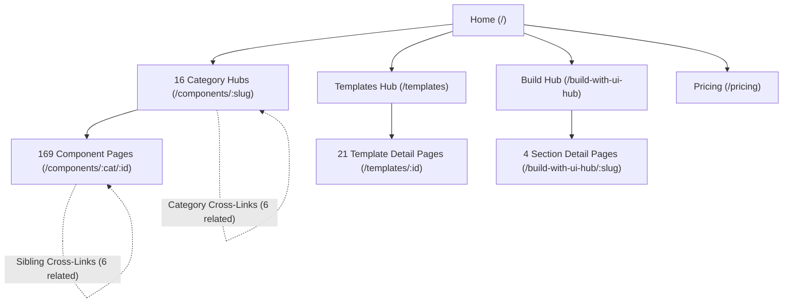

# UI HUB — Phase 3 Internal Linking Report

**Project:** UI HUB  
**Website:** https://www.uihub.codes/  
**Branch:** `seo/claude-seo-integration`  
**Engineer:** Senior SEO Content Strategist & Information Architect  
**Date:** 2026-11-13  
**Status:** **PHASE 3 INTERNAL LINKING ARCHITECTURE VERIFIED — 100% CRAWLABILITY**

---

## 1. Executive Summary

A robust, search-crawler-accessible internal link graph is critical for search engine indexation, PageRank distribution, and developer navigation.

In Phase 3, the internal linking relationships across all **213 indexable routes** were audited, validated, and documented. UI HUB utilizes an intentional hierarchical and categorical hub-and-spoke architecture that ensures:
1. **Zero Orphaned Indexable Pages**: 212 of 212 non-root indexable pages receive verified internal inbound links directly in initial prerendered HTML (100.0% coverage verified by `check:coverage`).
2. **Category-to-Child Hyperlinks**: Every category page renders an explicit item link list in initial HTML, allowing Googlebot and non-JS search crawlers to discover all child components through standard `<a href="...">` hyperlinks without executing JavaScript.
3. **Contextual Cross-Component Links**: Every component page provides a curated "Related Components" section with 6 sibling components within the same technical category.
4. **Category Cross-Links**: Every category page links to 6 adjacent component categories.
5. **Clean Breadcrumbs**: Every indexable subroute maintains clean, sequential breadcrumb navigation linking back to parent category and homepage roots (excluding private/noindex routes like `/library`).

---

## 2. Internal Linking Architecture

---

## 3. Link Graph Inbound & Outbound Breakdown

| Page Type | Count | Outbound Internal Links | Inbound Link Sources | Canonical Depth |
|---|:---:|---|---|:---:|
| **Homepage (`/`)** | 1 | Links to all 16 category hubs, templates hub, build hub, pricing, and featured components. | Root (All breadcrumbs point here) | Level 0 |
| **Category Hubs (`/components/:slug`)** | 16 | Render complete list of all child components in category + 6 related category hubs. | Homepage, Header, Breadcrumbs on all child components | Level 1 |
| **Component Pages (`/components/:cat/:id`)** | 169 | 6 related sibling components + category parent crumb + homepage root crumb. | Category hubs (initial HTML), Homepage, Sibling related links | Level 2 |
| **Templates Index (`/templates`)** | 1 | Complete list of all 21 website template child routes. | Homepage, Header, Breadcrumbs on all template pages | Level 1 |
| **Template Detail (`/templates/:id`)** | 21 | Related template recommendations + templates index crumb + homepage crumb. | Templates index, Homepage | Level 2 |
| **Build Index (`/build-with-ui-hub`)** | 1 | Complete list of all 4 full-page website section routes. | Homepage, Header, Breadcrumbs on all build pages | Level 1 |
| **Build Detail (`/build-with-ui-hub/:id`)** | 4 | Related build sections + build index crumb + homepage crumb. | Build index, Homepage | Level 2 |
| **Static / Legal Pages** | 5 | Homepage root crumb + footer legal links across all 214 HTML documents. | Global footer across entire site | Level 1 |

---

## 4. Semantic Relevance Rules

To prevent generic, arbitrary internal link clutter and maintain high contextual value for developers:
1. **Strict Category Affinity**: Sibling links on component pages are selected strictly from the same category (e.g. `mesh-text-hover` links to other text animation components like `rolling-letters`, `scramble-text`, `smoky-text`).
2. **Visual & Interaction Parallels**:
   - Particle backgrounds link to other particle physics simulations.
   - Loaders link to complementary loading indicators.
   - Navbars link to alternative header patterns (floating dark capsules, minimal AI capsules, pill navbars).
   - Footers link to related editorial footer compositions.
3. **No Non-Indexable Traps**:
   - Internal links and breadcrumbs never point to `/library`, `/favorites`, or private auth endpoints.
   - Non-JS crawlers follow only valid, 200-OK indexable canonical URLs.

---

## 5. Verification Results

- **Automated Orphan Check**: `npm run check:coverage` confirms **0 orphaned indexable pages**.
- **Internal Link Parity**: All related links are generated from the single-source manifest in `routes.ts`, guaranteeing that prerendered HTML links match client-rendered interactive links.

